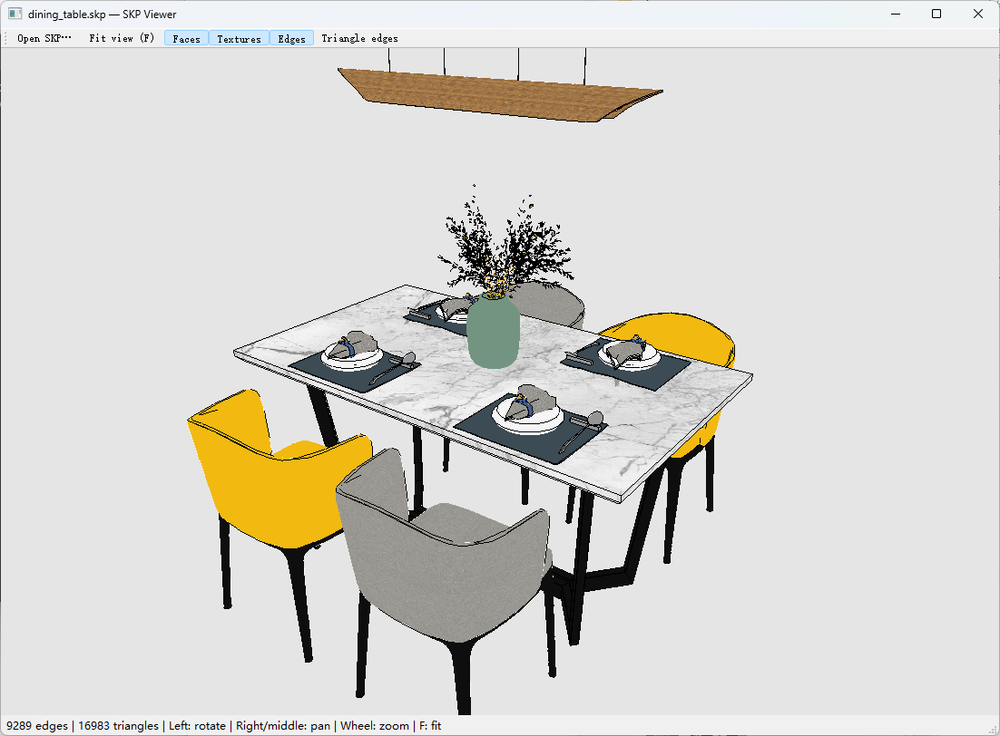
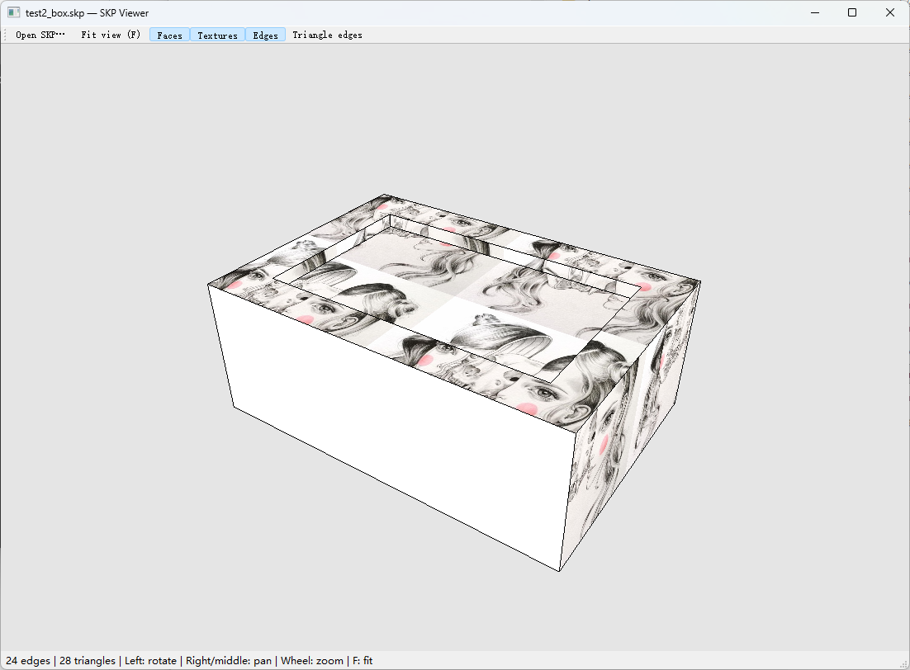

# SKP Viewer

通过ERA逆向分析.skp文件格式，开发的.skp文件viewer，感谢[REA](https://github.com/morluto/rea)开源贡献

由于SketchUp的版权显示，所有使用SketchupSDK中的.dll读取或写入.skp文件都将侵权

本项目不依赖SketchupSDK，完全重新编写的C++读写skp代码

viewer使用 PyQt5 和 PyOpenGL

C++ 负责解析模型、拓扑、材质和贴图，并通过 DLL 接口提供数据；Python 负责交互界面和 OpenGL 渲染。运行时无需安装 SketchUp，也不依赖原版 `slapi.dll`。

> 当前支持经过测试的 SKP 15 / 17 文件变体，提供读取相关的部分兼容接口，其他版本还未支持。详细范围见[已知限制](#已知限制)。

## 效果预览

**材质与组件显示**



**基础模型与纹理映射**



## 功能

- 读取顶点、边、面、外环与内环，以及组和组件实例。
- 递归应用组件变换，以透视投影显示模型。
- 多边形三角化：凸多边形且仅含一个外环时使用 fan；凹多边形或带孔面使用 libtess2。
- 显示正反面材质、组与实例的继承材质，以及嵌入的 PNG / JPEG / TGA 贴图。
- 支持 UVQ 纹理映射、HLS 颜色调整、图像 Alpha 和材质透明度。
- 隐藏 Hidden 和 Soft 边，保留它们参与面的拓扑构建。
- 独立切换面、贴图、原始边线和三角网格显示。
- 默认浅灰背景、白色空材质、黑色 1 像素边线。

## 环境要求

| 项目 | 要求 |
| --- | --- |
| 系统 | Windows，当前运行方案为 x64 |
| C++ 构建 | Visual Studio 2019，安装“使用 C++ 的桌面开发” |
| 构建工具 | CMake 3.15 或以上，命令行可用 |
| Python | 64 位，当前已验证 Python 3.8 |
| 图形环境 | 支持 OpenGL 2.1 兼容上下文的显卡驱动 |
| Python 依赖 | PyQt5 5.15.11、PyOpenGL 3.1.7、Pillow 10.4.0 |

Python 与 DLL 必须同为 **64 位**。仓库不包含编译产物，首次使用需先构建 DLL。

## 快速开始

以下命令在 Windows **命令提示符（cmd）** 中执行。

### 1. 获取项目

```bat
git clone https://github.com/lihang185/skp_viewer.git
cd skp_viewer
```

### 2. 构建 C++ DLL

```bat
build.bat
```

脚本使用 VS2019 生成器构建 x64 Release，产物包括：

- `build_x64\Release\slapi.dll`：独立实现的读取 DLL。
- `build_x64\Release\read_model.exe`：C++ 读取示例。
- `build_x64\skp_viewer.sln`：可在 VS2019 中打开的解决方案。

### 3. 安装 Python 依赖

建议创建项目虚拟环境：

```bat
py -3.8-64 -m venv .venv
install_dependencies.bat
```

启动脚本按以下顺序选择 Python：

1. 环境变量 `SKP_VIEWER_PYTHON` 指定的解释器。
2. 项目内 `.venv\Scripts\python.exe`。
3. 本地备用路径 `C:\python\Python38\python.exe`。
4. Python Launcher 的 `py -3-64`。

也可以指定自己的 64 位解释器路径：

```bat
set "SKP_VIEWER_PYTHON=C:\path\to\python.exe"
install_dependencies.bat
```

### 4. 启动查看器

```bat
run_viewer.bat
```

默认打开根目录的 `test2_box.skp`。指定其他模型：

```bat
run_viewer.bat "data\dining_table.skp"
```

也可双击 `run_viewer.bat`，把 `.skp` 文件拖到该脚本上，或在窗口中使用 **Open SKP / Ctrl+O** 打开文件。

## 操作方式

| 操作 | 功能 |
| --- | --- |
| 鼠标左键拖动 | 旋转模型 |
| 右键 / 中键拖动，或 Shift + 左键拖动 | 平移视图 |
| 鼠标滚轮 | 缩放 |
| F / 双击 / Fit view | 适配模型到窗口 |
| Ctrl+O / Open SKP | 打开模型 |
| Faces | 显示或隐藏面 |
| Textures | 开关贴图 |
| Edges | 开关原始 CEdge 边线 |
| Triangle edges | 查看三角化网格，默认关闭 |

## 项目结构

```text
skp_viewer/
├─ viewer/          Python 界面、ctypes 读取和贴图解码
├─ src/             C++ 归档解析、模型、三角化和 DLL 接口
├─ include/         公共接口及内部数据结构
├─ third_party/     libtess2 源码与许可证
├─ tools/           C++ 读取示例和模型检查工具
├─ tests/           C++ / Python 测试与贴图对照样本
├─ data/            38 个 SKP 测试模型
├─ analysis/        测试报告和截图输出
├─ test2_box.skp    默认测试模型
├─ build.bat        构建 x64 DLL
├─ run_viewer.bat   启动查看器
└─ test.bat         运行回归测试
```

`build_x64/` 是构建时生成的目录，不纳入版本管理。根目录与 `data/` 下的 `test2_box.skp` 是两个不同版本的测试文件。

## C++ 接口与数据流程

```text
SKP 文件 → 归档解析 → 模型 / 拓扑 / 材质 → ctypes → OpenGL 显示
```

- [slapi_compat.h](include/slapi_compat.h)：读取相关的公开兼容接口。
- [skp_mesh_api.h](include/skp_mesh_api.h)：三角网格、贴图、UVQ 和边属性等项目扩展接口。
- [read_model.cpp](tools/read_model.cpp)：C++ 客户端调用示例。

项目扩展采用 `SKP` 前缀，具体支持范围以头文件为准。

## 测试

构建并安装依赖后执行：

```bat
test.bat
```

测试覆盖 C++ 解析与几何接口、三角化、贴图解码与颜色处理，以及 `data/` 中全部 38 个模型的加载。当前基线已通过 45 项 C++ 测试和 38 个模型的贴图加载检查。

保存一次实际 OpenGL 渲染截图：

```bat
python.bat viewer\viewer.py data\dining_table.skp --screenshot analysis\dining_table.png
```

## 已知限制

- 只支持已验证的 SKP 15 / 17 文件变体，不保证其他版本或未知对象类型能够读取。
- 当前聚焦文件读取与显示，不提供完整 SketchUp SDK 功能或模型保存功能。
- 尚未应用图层可见性；边线显示会过滤 Hidden 和 Soft 属性。
- 损坏或退化的 UV 映射会回退到默认平面映射，并在状态栏提示。
- 透明材质采用排序绘制，复杂交叠场景不保证与 SketchUp 的渲染结果完全一致。

## 第三方依赖

多边形三角化使用 [libtess2](third_party/libtess2)，本项目将 `TESSreal` 调整为 `double`。来源与改动见 [UPSTREAM.txt](third_party/libtess2/UPSTREAM.txt)，许可见 [LICENSE.txt](third_party/libtess2/LICENSE.txt)。

Python 依赖版本见 [requirements.txt](viewer/requirements.txt)。
